# MovieShelf – Personal Movie Collection App

An offline React Native (Expo) app for browsing movies, getting a movie suggestion that matches your mood,
and keeping a personal list of favourites, with registration, login and a user profile.
Built for **ICA 03 – Individual React Native Project**.

---

## 1. Project Overview / Objective

**MovieShelf** is a mobile app where a movie lover can browse a collection of movies, filter them by
genre, search by title, read full movie details and save favourites. Users create their own account,
log in, reset a forgotten password and manage their profile.

**Objectives of the project**
- Build a multi-screen mobile application with React Native and Expo.
- Use bottom-tab and stack navigation (React Navigation).
- Work with a **local dataset** and local images, with **no API, Firebase or online database**.
- Store data on the device (favourites and user accounts) so it stays after the app is closed.
- Add a unique feature of my own: the **Movie Mood Matcher**.

---

## 2. Key Features

**Browsing movies**
- Home screen with popular and recently added movies and quick links
- All Movies screen in a two-column poster grid
- Genre filtering (8 genres) and live search by title
- Movie Details screen with poster, genre, rating, director, cast and a full description
- Favourites: add or remove a movie, saved on the device

**Movie Mood Matcher (unique feature)**
- Choose a mood: Happy, Relaxed, Excited or Thrilled
- Choose a duration: Under 90 minutes, 90–120 minutes or Any duration
- "Find My Movie" filters the local dataset and picks one matching movie at random
- Shows the poster, title, genre, rating and description, with a button to open the full Movie Details
- Friendly message when no movie matches

**User accounts**
- **Registration** with validation (name, email, password, confirm password, security question)
- **Login** with the session kept after restarting the app
- **Forgot password** using a security question
- **Profile** with avatar, email, member-since date, your favourite movies, edit name, change password and log out

---

## 3. Screenshots of the Application


### Authentication

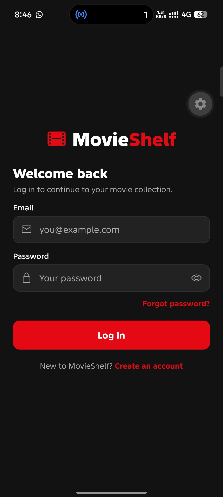
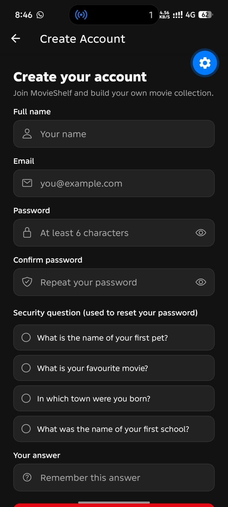
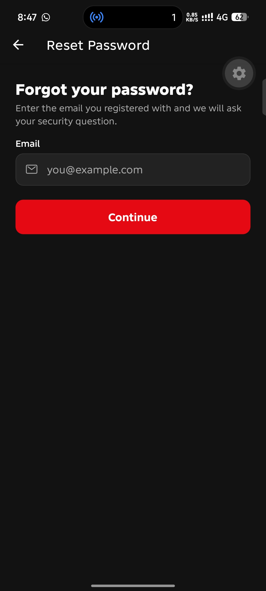

### Browsing movies

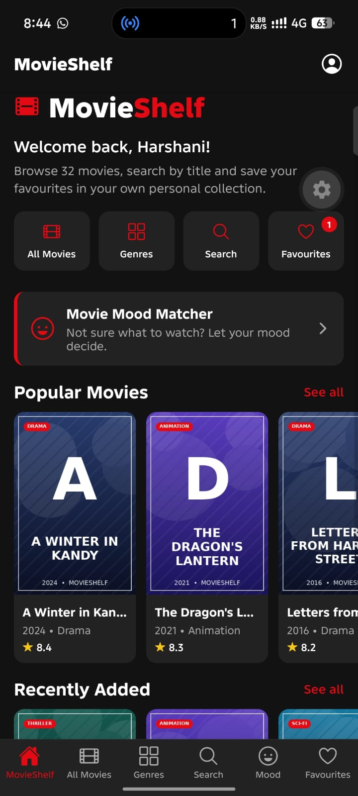
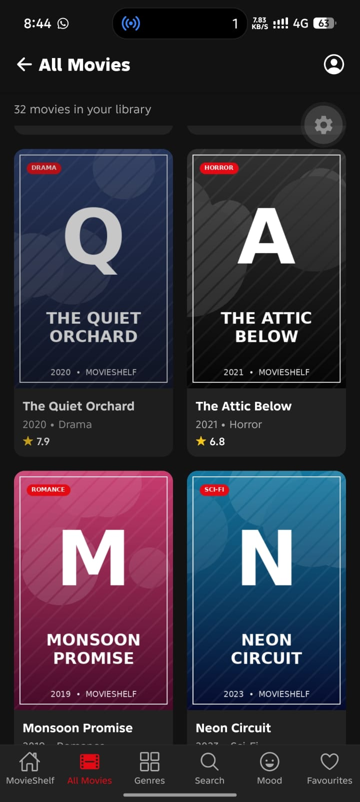
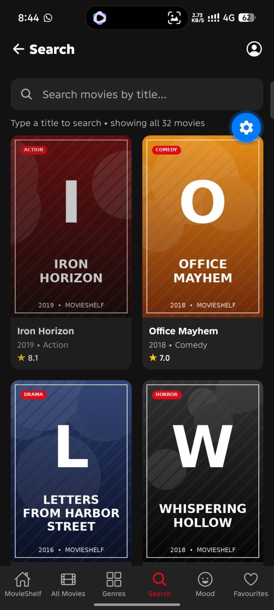
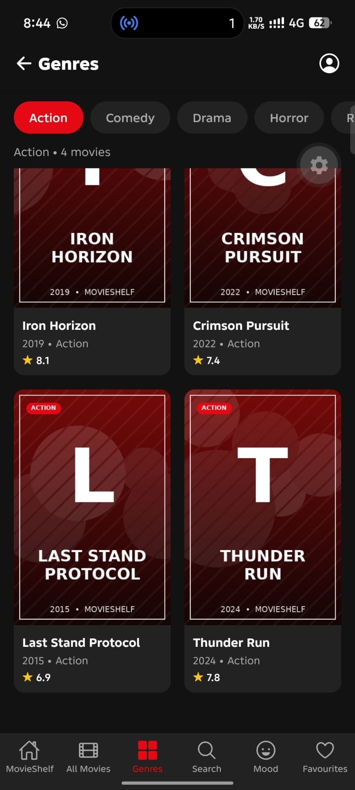
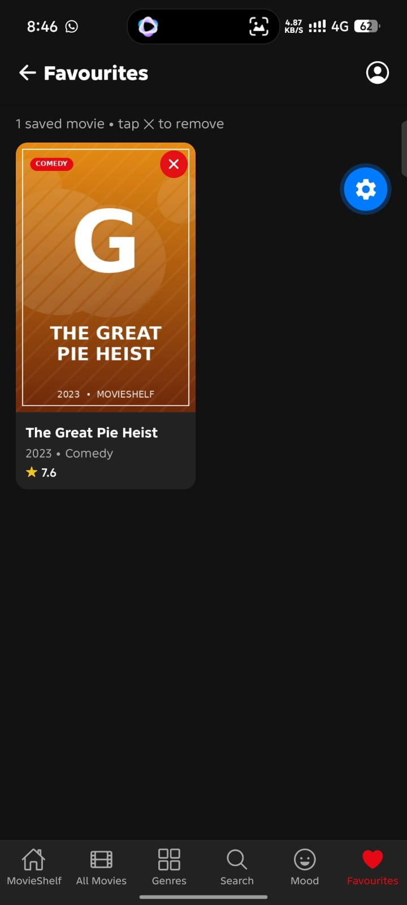

### Movie Mood Matcher

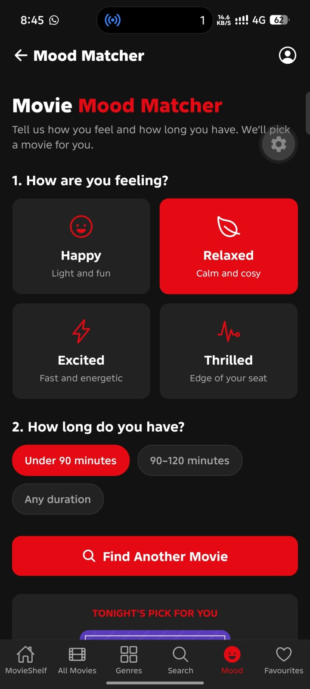
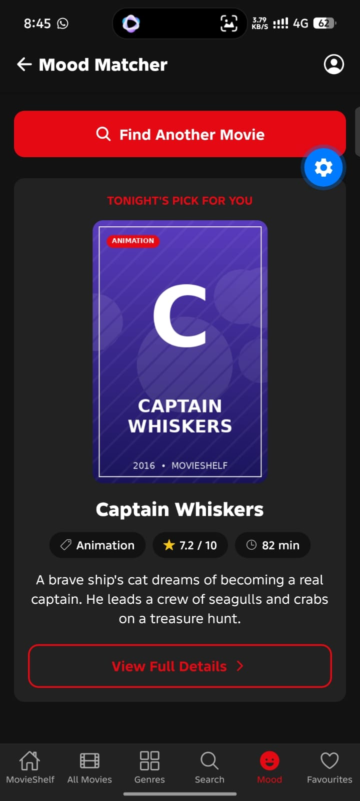

### Profile

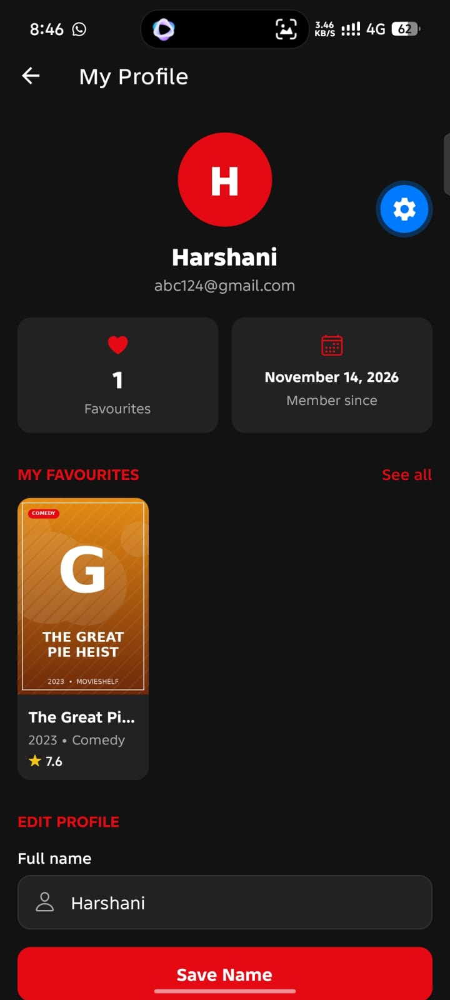

---

## 4. Technologies Used

**JavaScript (ES6+)**   | Programming language |
**React Native**        | Building the mobile user interface |
**Expo (SDK 58)**       | Running, building and testing the app |
**React Navigation**    |(bottom tabs + native stack) | Screen navigation |
**React Context API**   | Sharing favourites and login state across screens |
**AsyncStorage**        | Saving favourites and user accounts on the device (offline) |
**@expo/vector-icons (Ionicons)** | Icons |
**react-native-web**    | Running the app in a browser |
**Local JS dataset + local images** | Movie data and posters (no API or database) |

---

## 5. Project Structure

```
MovieShelf/
├── App.jsx                       # theme + providers + navigation container
├── index.js                      # Expo entry point
├── app.json
├── assets/movies/                # 32 local poster images
├── screenshots/                  # screenshots used in this README
├── components/
│   ├── MovieCard.jsx             # reusable poster card
│   ├── MovieGrid.jsx             # reusable two-column grid
│   ├── EmptyState.jsx            # "nothing found" message
│   └── AuthInput.jsx             # styled input with icon, error text and show/hide password
├── constants/theme.js            # colours and spacing (dark theme, red accent)
├── context/
│   ├── FavouritesContext.jsx     # favourites logic + AsyncStorage
│   └── AuthContext.jsx           # register, login, profile, password reset + AsyncStorage
├── data/movies.js                # the local dataset (32 movies with mood and duration)
├── navigation/AppNavigator.jsx   # login gating + tabs + stack
├── utils/
│   ├── validation.js             # name, email and password checks
│   └── securityQuestions.js      # security questions for password reset
└── screens/
    ├── HomeScreen.jsx
    ├── AllMoviesScreen.jsx
    ├── GenresScreen.jsx
    ├── SearchScreen.jsx
    ├── MoodMatcherScreen.jsx
    ├── MovieDetailsScreen.jsx
    ├── FavouritesScreen.jsx
    ├── LoginScreen.jsx
    ├── RegisterScreen.jsx
    ├── ForgotPasswordScreen.jsx
    └── ProfileScreen.jsx
```

**Navigation**
- **Logged out:** Login → Register / Forgot Password
- **Logged in:** bottom tabs (Home, All Movies, Genres, Search, Mood, Favourites) + Movie Details + Profile
- The person icon at the top right of each tab opens the Profile. Every screen except Home and Login has a back arrow.

---

## 6. Installation and Setup Instructions

**Requirements:** Node.js (LTS) and the **Expo Go** app on your phone (or an Android emulator).

```bash
# 1. open the project folder
cd MovieShelf

# 2. install the dependencies
npm install

# 3. install AsyncStorage (Expo picks the version that matches your SDK)
npx expo install @react-native-async-storage/async-storage

# 4. make sure every package matches the Expo SDK (safe to run)
npx expo install --fix

# 5. start the app
npx expo start
```

- Scan the QR code with **Expo Go** (Android) or the Camera app (iOS).
- Press `a` for an Android emulator, or `w` to open it in the browser.
- If the app shows old data or errors after changes, restart with `npx expo start -c`.
- On first launch you will see the Login screen. Tap **Create an account** to register.

---

## 7. Other Important / Special Features

- **Works 100% offline:** no API, no Firebase, no backend. Posters, movie data, favourites and accounts all live on the device.
- **Dataset with mood and duration:** every movie has `mood` (for example `["Happy", "Relaxed"]`) and `duration` (minutes), which the Mood Matcher uses.
  Duration rules: under 90 = less than 90 minutes, 90–120 = 90 to 120 minutes inclusive.
- **Favourites linked to Profile:** the Profile screen shows your favourite movies from the same list as the Favourites tab, so both always stay in sync.
- **Secure-style password storage:** passwords and security answers are saved as salted hashes, never as plain text.
- **Persistent login:** the user stays logged in after closing the app, until they press Log Out.
- **Input validation:** email format, password length, matching passwords and duplicate-email checks.
- **Easy to extend:** to add a movie, copy an object in `data/movies.js`, use the next free `id`, keep all fields and point `poster` at an image in `assets/movies/`. Every screen, including the Mood Matcher, picks it up automatically.

**Viewing saved account data:** accounts are stored under the AsyncStorage key `movieshelf_users`.
In the browser (`npx expo start --web`), open DevTools (F12) → **Application → Local Storage**.

**Security note:** the login is local to the device so the app works offline, and the password hashing is a simple custom function suited to a learning project.
A production app would use a server, email-based password reset and a library such as bcrypt.
Accounts created before the security question was added cannot use Forgot Password; register a new account or clear the app data.

**Replacing the posters:** the poster images are original generated artwork (movie titles are fictional).
To use your own, put images in `assets/movies/` and update the `require('../assets/movies/...')` line in `data/movies.js`.

---

## Adding the Project to GitHub

```bash
git init
git add .
git commit -m "Initial commit: MovieShelf app"
git branch -M main
git remote add origin https://github.com/Harshani557/MovieShelf.git
git push -u origin main
```

